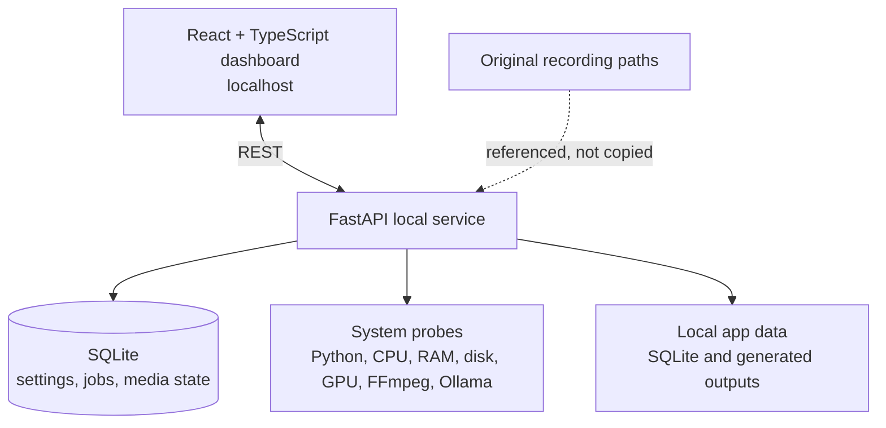

# Architecture

## Goals

- Keep media and metadata on the creator's machine by default.
- Use one Python service and one local UI, with SQLite for durable state.
- Keep processing modules replaceable and run long work as resumable jobs.
- Never overwrite source recordings; write generated media separately.
- Require a person to approve publication unless the creator explicitly changes policy.

## Phase 1 structure

## Planned processing path

```mermaid
flowchart LR
    Import[Authorized local recording] --> Probe[ffprobe metadata]
    Probe --> Analyze[Audio and scene signals]
    Analyze --> ASR[faster-whisper transcript]
    ASR --> Score[Candidate scoring with context]
    Score --> Render[FFmpeg clip and vertical render]
    Render --> Review[Human review and correction]
    Review --> Approve[Explicit publish approval]
    Approve --> YouTube[YouTube OAuth upload]
```

## Technology choices

| Area | Choice | Reason | Alternatives |
| --- | --- | --- | --- |
| API | FastAPI on Python 3.12 | Small typed API; Python media and AI ecosystem | Flask, Django |
| UI | React, TypeScript, Vite | Responsive interactive dashboard with type checking | Vue, Svelte, server-rendered templates |
| State | SQLite | No separate database service; durable local state | DuckDB for analytics, PostgreSQL for multi-user deployments |
| Media | FFmpeg and ffprobe | Mature probing, transcoding, filtering, and subtitle tools | GStreamer, OpenCV for selected vision tasks |
| Transcription | faster-whisper | Local Whisper inference with quantized CPU/GPU modes | whisper.cpp, upstream Whisper |
| Context and metadata | Ollama local API | No paid hosted LLM required | Rule templates, another local model runner |

## Operating boundaries

The service binds to loopback. The browser UI uses same-origin API paths in a production build and a narrow localhost proxy in development. SQLite contains application state, not video bytes. The output directory is separate from source directories. YouTube access is an opt-in OAuth integration and is not part of the current phase.

